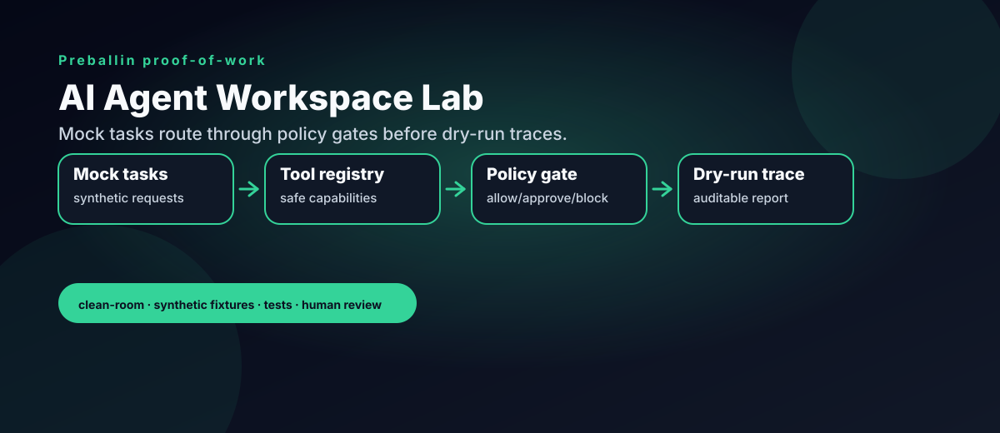

# AI Agent Workspace Lab

Simulated clean-room agent workspace patterns for task routing, mock tools, approval boundaries, and dry-run orchestration.

This repo is public proof-of-work for AI workflow design, not a dump of private assistant infrastructure. It uses synthetic tasks, mock tools, and deterministic policy checks to show how agent-like workflows can be made auditable and human-reviewable.



## Safety boundary

This repository includes reference demos, selected operating functions and a public aggregate case study. It excludes private machine addresses, paths, raw chats, assistant memory, credentials, account sessions, customer-level records, private strategy and live external actions. The core workspace demo uses mock tools and synthetic tasks.

## What it demonstrates

- Mock tool registry
- Policy decisions for allow / approval-required / blocked actions
- Dry-run task routing
- Markdown trace reports
- Tests and GitHub Actions CI

## Example

```bash
PYTHONPATH=src python -m agent_workspace_lab.demo \
  --config examples/mock_workspace_config.json \
  --output reports/generated/dry_run_trace.md
```

Run tests:

```bash
PYTHONPATH=src pytest -q
```

## Framing

The goal is to show clean workflow architecture: separate routing from policy, require approval for external actions, block dangerous actions, and generate a trace that a human can review.

## Recent operating work: October 2026

- [AI discovery case study](docs/ai-discovery-case-study.md): six booked lesson students confirmed ChatGPT discovery; 40 measured ChatGPT sessions are reported separately.
- [Scheduled systems catalog](docs/scheduled-systems.md): discovery reporting, gap radar, site checks, bookmark intake, lead operations, content planning, fleet history, and health checks.
- Offline examples: `python examples/aio_report.py examples/aio_aggregate.json` and `python examples/cron_replay.py`.

The reference demos, selected operating functions and aggregate business case study have different scopes; the linked catalog explains each. Private production prompts, customer data, infrastructure, and unreleased product plans remain private.

---

Part of the [Preballin](https://preballin.com) clean-room portfolio — patterns from production systems, rebuilt with synthetic data.

### Selected operating engines

The [scheduled systems catalog](docs/scheduled-systems.md) now includes selected AIO HTML inspection and cron delivery-gate functions from the operating implementation. The [local audit runner](examples/aio_audit.py) exposes unreadable input, changed output and restored coverage. A fictional fixture makes it reproducible without accounts or network access.
